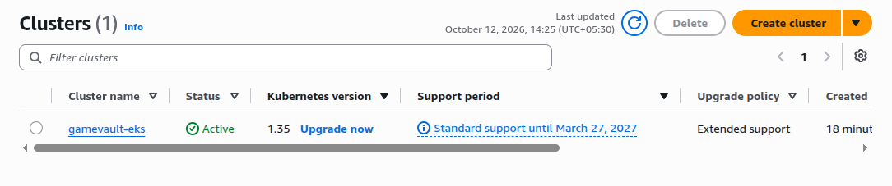
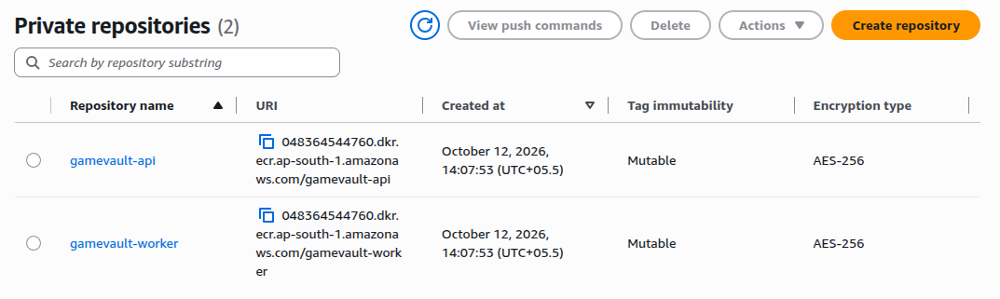
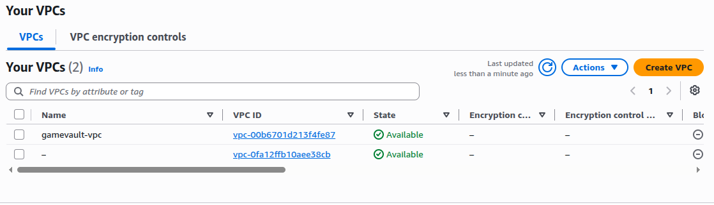
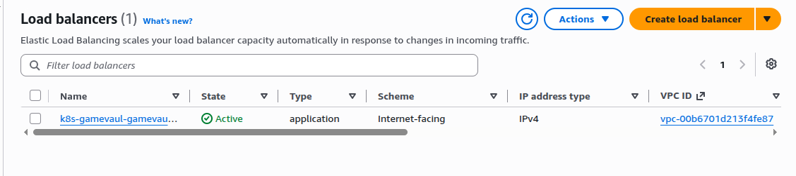
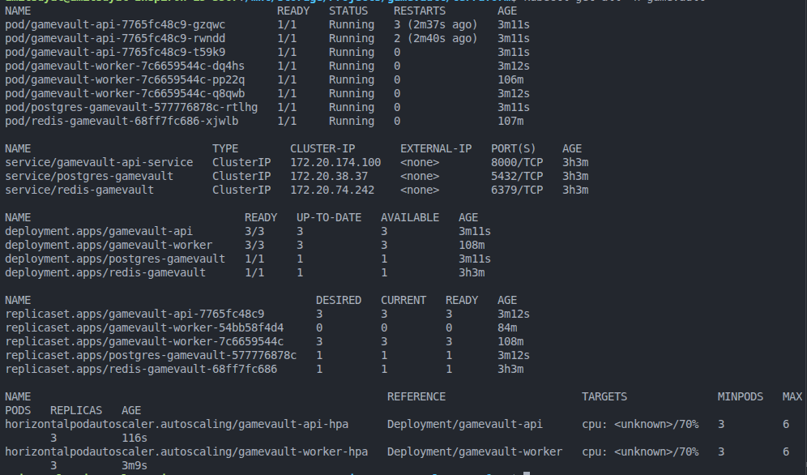
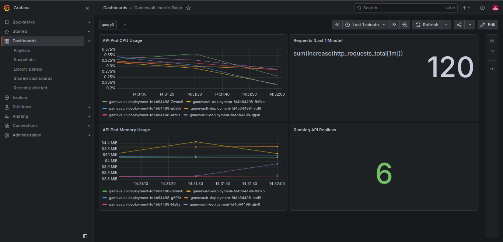
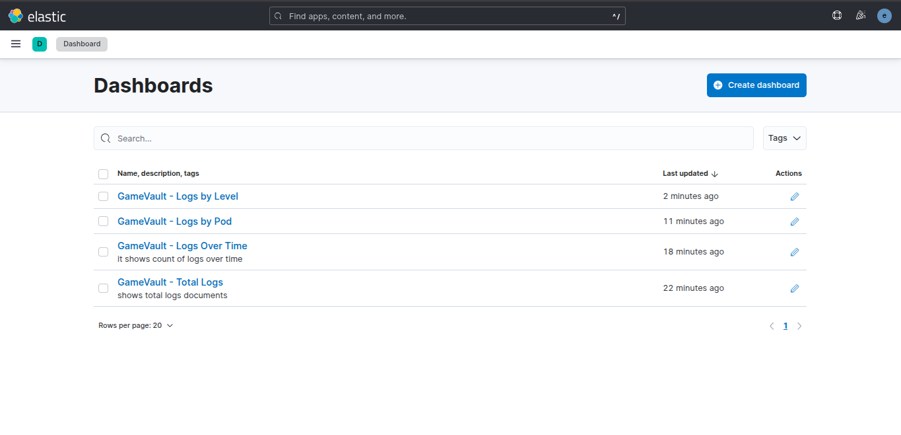

# GameVault

**A containerized game leaderboard platform deployed on AWS using Docker, Kubernetes, and Terraform.**

GameVault is a cloud deployment project built to explore containerized applications, Kubernetes orchestration, AWS infrastructure, background job processing, and monitoring and logging.

The project uses FastAPI for the API, PostgreSQL for persistent data, Redis for queue management, and a separate worker for background processing. Its infrastructure was deployed on Amazon EKS using Terraform.

## Architecture

```text
                 Internet
                    |
                    v
            Application Load Balancer
                    |
                    v
             Kubernetes Ingress
                    |
                    v
              GameVault API
                    |
             +------+------+
             |             |
             v             v
           Redis       PostgreSQL
             ^
             |
      GameVault Worker
```

The application components run as containerized workloads, while AWS provides the infrastructure and Kubernetes manages their deployment.

## Technology Stack

| Category | Technologies |
|---|---|
| Backend | Python, FastAPI |
| Database | PostgreSQL |
| Queue | Redis |
| Background processing | Python worker |
| Containers | Docker, Docker Compose |
| Orchestration | Kubernetes, Amazon EKS |
| Cloud infrastructure | AWS VPC, EC2, ECR, IAM, EBS |
| Infrastructure as Code | Terraform |
| Traffic management | AWS Load Balancer Controller, Application Load Balancer |
| Monitoring | Prometheus, Grafana |
| Logging | Fluent Bit, Elasticsearch |

## Features

- REST API built with FastAPI.
- PostgreSQL for persistent application data.
- Redis-based queue for background jobs.
- Separate worker for processing queued tasks.
- Docker-based application packaging.
- Local multi-container setup using Docker Compose.
- Kubernetes Deployments and Services.
- AWS EKS deployment with managed worker nodes.
- AWS ECR repositories for container images.
- Internet-facing application access through an AWS Application Load Balancer.
- Persistent storage integration using Amazon EBS.
- Monitoring and logging components for infrastructure visibility.

## Project Structure

```text
GameVault/
├── app/
│   └──                 # API application source
├── worker/
│   └──                 # Background worker source
├── Dockerfile
├── docker-compose.yml
├── requirements.txt
├── terraform/
│   ├── main.tf
│   ├── variables.tf
│   ├── outputs.tf
│   ├── providers.tf
│   ├── versions.tf
│   └── modules/
│       ├── network/
│       ├── ecr/
│       ├── eks/
│       ├── alb-controller/
│       └── gamevault-kubernetes/
├── docs/
└── README.md
```


## Run Locally

### Prerequisites

- Docker
- Docker Compose

Clone the repository:

```bash
git clone https://github.com/Amit021020/gamevault.git
cd gamevault
```

Build and start the local environment:

```bash
docker compose up -d --build
```

Check the running containers:

```bash
docker compose ps
```

View the service logs:

```bash
docker compose logs -f
```

Stop the environment:

```bash
docker compose down
```

The local setup uses the services defined in the Compose configuration. Refer to the application's configuration for its API address and any required environment variables.

## AWS Deployment

GameVault was deployed to AWS using Terraform and Amazon EKS.

The infrastructure included:

- A VPC with public and private subnets.
- An Amazon EKS cluster and managed node group.
- Amazon ECR repositories for the API and worker images.
- IAM roles and permissions for the required AWS integrations.
- AWS Load Balancer Controller for Kubernetes Ingress.
- An Application Load Balancer for external HTTP traffic.
- EBS-backed persistent storage integration.

The deployed EKS cluster was named `gamevault-eks`, and the Kubernetes namespace was `gamevault`.

The cloud deployment was used to test the infrastructure and capture evidence of the setup. The AWS resources were intended to be removed after the deployment work to avoid unnecessary ongoing costs. The Terraform configuration remains in the repository.

## Terraform

Terraform defines the AWS infrastructure through reusable modules.

The configuration separates networking, ECR, EKS, load balancer integration, and Kubernetes resources into their respective modules.

To validate the Terraform configuration, navigate to the Terraform directory:

```bash
cd terraform
terraform init
terraform fmt -recursive
terraform validate
```

Review the planned infrastructure changes before making modifications:

```bash
terraform plan
```

To recreate the infrastructure, configure AWS credentials and confirm that the Terraform variables and required permissions are correct before applying:

```bash
terraform apply
```

**Cost note:** Amazon EKS, EC2 worker nodes, EBS volumes, load balancers, public IPv4 addresses, and NAT Gateways can incur charges. Review the plan carefully and destroy resources when they are no longer required.

For more details, see [`terraform.md`](terraform.md).

## Monitoring and Logging

Prometheus and Grafana were included in the project's monitoring setup to provide visibility into the deployed environment.

Fluent Bit and Elasticsearch were included in the logging setup to support log collection and analysis.

Screenshots in the next section document the monitoring and logging configuration used during the deployment.

## Screenshots

The screenshots below document the AWS infrastructure, Kubernetes deployment, application access, and monitoring setup.


### Suggested folder structure

```text
docs/
└── screenshots/
    
```


### AWS Infrastructure

**Amazon EKS Cluster**




**Amazon ECR Repositories**



**VPC and Networking**



**Application Load Balancer**



### Kubernetes Deployment

**Kubernetes Workloads**




### Monitoring and Logging

**Grafana Dashboard**



**Elastic Search Dashboard**




## Key Learnings

Working on GameVault provided practical experience with:

- Containerizing services with Docker.
- Running multiple services through Docker Compose.
- Deploying workloads on Kubernetes.
- Provisioning AWS infrastructure with Terraform.
- Configuring EKS networking and managed node groups.
- Managing container images through Amazon ECR.
- Integrating Kubernetes Ingress with AWS load balancing.
- Configuring persistent storage with Amazon EBS.
- Understanding AWS IAM permissions and infrastructure dependencies.
- Using monitoring and logging tools to inspect a deployed environment.
- Managing cloud resources carefully to control costs.

## Project Status

The GameVault deployment and infrastructure work has been completed and documented. The AWS environment was used for deployment testing and screenshots, while the source code and Terraform configuration were retained for reference and redeployment.

## Author

**Amit Suyal**

- GitHub: [Amit021020](https://github.com/Amit021020)
- LinkedIn: [Amit Suyal](https://linkedin.com/in/amit-suyal-495628343)